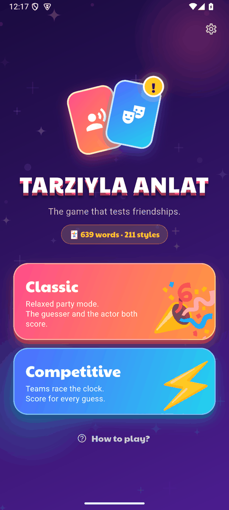
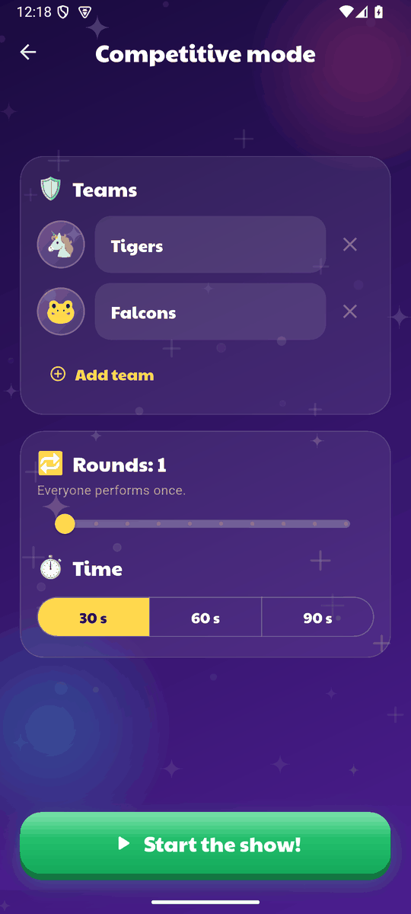
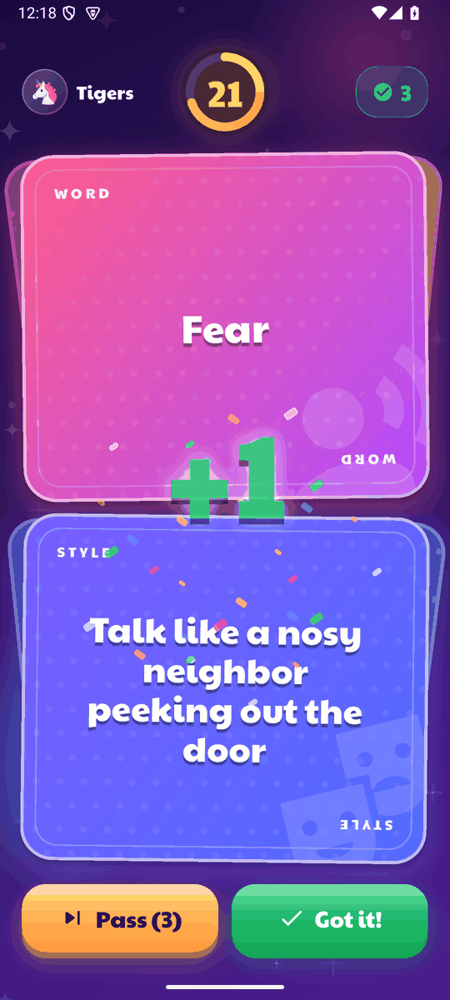
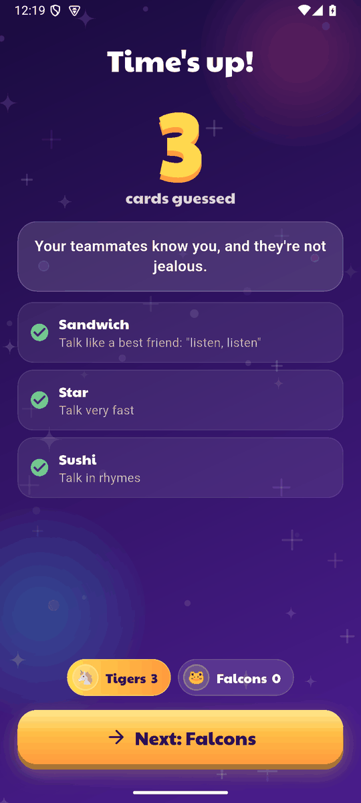
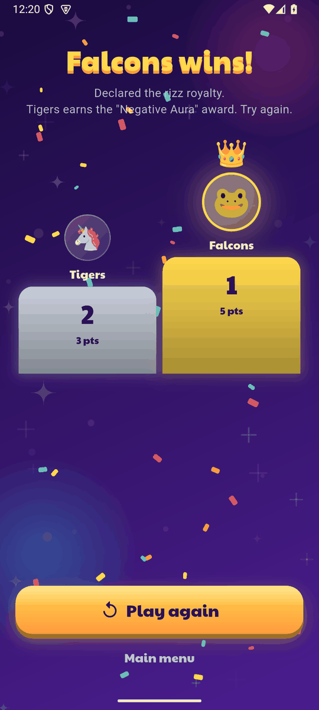

# Tarzıyla Anlat

**A free, open-source charades-style party game for friends. Plays in English and Türkçe.**
**Arkadaşlarla oynanan ücretsiz, açık kaynaklı, komik bir kelime anlatma oyunu. Türkçe ve İngilizce.**

[](https://github.com/gulheda/tarziyla-anlat/actions/workflows/ci.yml)
[](LICENSE)
[](https://flutter.dev)
[](#languages--diller)

**▶ Play now / Hemen oyna:** https://guileless-pithivier-46ef21.netlify.app
**⬇ Android APK:** [latest release](https://github.com/gulheda/tarziyla-anlat/releases/latest)

<p align="center">
  
  
  
  
  
</p>

---

## English

Looking for an **open-source charades game**, a **word-guessing party game** or an **acting game** you can play with friends on one phone? This is it.

### How to play
1. The player whose turn it is takes the phone.
2. Two cards appear: the **WORD** card says *what* to act out, the **STYLE** card says *how*.
   For example **"Penguin"** + **"Talk like your grandma"**.
3. Describe the word without saying it, staying true to your style. The others guess.
4. Swipe the cards **right** for "Got it", **left** for "Pass" (or use the buttons).
5. After the last round the highest score wins. The last place gets the stage fright award.

One tap per turn: press "Next" on the result screen and the 3‑2‑1 countdown starts by itself.

### Features
- 🎭 **639 words and 211 styles** in English, and the same amount in Turkish. Tens of thousands of combinations.
- 👥 2–8 players or teams, 30/60/90 second turns, 1–10 rounds.
- 🎉 **Classic mode** (the guesser and the actor both score) and **Competitive mode** (teams race the clock).
- 🌍 **English and Türkçe**, picked from your device language or in Settings. Every card is written for its language, not machine-translated.
- 📴 Works offline. No ads, no accounts, no analytics, **no data collected**.
- ⏸ The clock pauses automatically when you leave the app. Wide-screen friendly, screen-reader labels, large-text safe.
- 📱 Android, iPhone (as a web app) and any browser. Built with [Flutter](https://flutter.dev).

### Run it yourself
```
flutter pub get
flutter gen-l10n
flutter run                 # connected device or emulator
flutter run -d chrome       # in the browser
flutter test                # 200+ tests: content, localization, game logic, layout
flutter build apk --release # Android
flutter build web --release # Web (PWA)
```

### Add cards or a language
All cards are plain Dart lists — adding a funny style is a one-line change. See [CONTRIBUTING.md](CONTRIBUTING.md).

| | English | Türkçe |
|---|---|---|
| Words | `lib/data/cards_en.dart` | `lib/data/cards.dart` |
| Styles | `enStyles` | `tarzCards` |
| Jokes | `lib/data/funny_en.dart` | `lib/data/funny.dart` |
| Interface | `lib/l10n/app_en.arb` | `lib/l10n/app_tr.arb` |

### Project layout
- `lib/logic/` game rules (rounds, scoring, pause-safe clock)
- `lib/screens/` and `lib/ui/` screens and shared widgets
- `lib/data/` card decks and jokes per language
- `lib/services/` saved settings and haptics
- `test/` unit, localization and layout tests
- `store/` store listings (EN/TR), privacy policy and release checklist

### Privacy
The app has no network code, ads or analytics and stores only your language, vibration setting and last game setup on your device. The web version loads its own files (and the emoji font) when you open it.

### License
Code: [MIT](LICENSE). The bundled font *Paytone One* is under the SIL Open Font License. All word and style cards are original; you may reuse them under the same MIT license.

---

## Türkçe

**Açık kaynaklı kelime anlatma oyunu** arıyorsan: telefonu elden ele verip oynadığın, komik bir parti oyunu.

### Nasıl oynanır?
1. Sırası gelen oyuncu telefonu alır.
2. İki kart çıkar: **KELİME** kartı ne anlatılacağını, **TARZ** kartı nasıl anlatılacağını söyler. Örneğin **"Penguen"** + **"Nenen gibi konuş"**.
3. Kelimeyi söylemeden, tarzına sadık kalarak anlat. Diğerleri tahmin eder.
4. Kartı **sağa** kaydırınca "Bildiler", **sola** kaydırınca "Pas" olur (butonlar da var).
5. Tüm turlar bitince en çok puanlı kazanır. Sonuncu sahne korkusu ödülünü alır.

Tur başına tek dokunuş: sonuç ekranında "Sıradaki"ne bas, 3‑2‑1 geri sayımı kendiliğinden başlar.

### Özellikler
- 🎭 **621 kelime ve 219 tarz** Türkçe, aynı büyüklükte İngilizce deste. On binlerce kombinasyon.
- 👥 2–8 oyuncu ya da takım, 30/60/90 saniye, 1–10 tur.
- 🎉 **Klasik mod** (bilen ve anlatan puan alır) ve **Rekabetçi mod** (takımlar sayaca karşı yarışır).
- 🌍 **Türkçe ve English**: cihaz dilinden ya da Ayarlar'dan seçilir. Kartlar makine çevirisi değil, her dil için ayrı yazıldı.
- 📴 İnternetsiz çalışır. Reklam yok, hesap yok, analiz yok, **hiçbir veri toplanmaz**.
- ⏸ Uygulamadan çıkınca süre kendiliğinden durur. Geniş ekran, ekran okuyucu ve büyük yazı desteği var.
- 📱 Android, iPhone (web uygulaması olarak) ve her tarayıcı. [Flutter](https://flutter.dev) ile yazıldı.

### Kendin çalıştır
```
flutter pub get
flutter gen-l10n
flutter run
flutter test
```

### Kart ekle ya da yeni dil ekle
Kartlar düz Dart listeleri, yeni bir tarz eklemek tek satır. Ayrıntılar için [CONTRIBUTING.md](CONTRIBUTING.md).

### Gizlilik
Uygulamada ağ kodu, reklam ya da analiz yok. Cihazında yalnızca dil, titreşim ayarı ve son oyun kurulumun saklanır. Web sürümü açılırken kendi dosyalarını (ve emoji yazı tipini) yükler.

### Lisans
Kod: [MIT](LICENSE). Uygulamayla gelen *Paytone One* yazı tipi SIL Open Font License altındadır. Tüm kelime ve tarz kartları özgündür; aynı MIT lisansı altında kullanabilirsin.

---

<sub>Keywords: charades game, party game, word guessing game, acting game, game for friends, group game, open source game, Flutter game, free game, kelime anlatma oyunu, parti oyunu, arkadaş oyunu, tahmin oyunu, mim oyunu, sessiz sinema, açık kaynak oyun.</sub>
